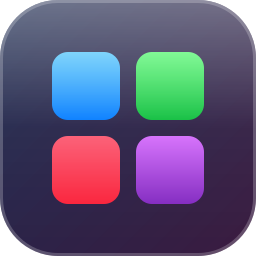
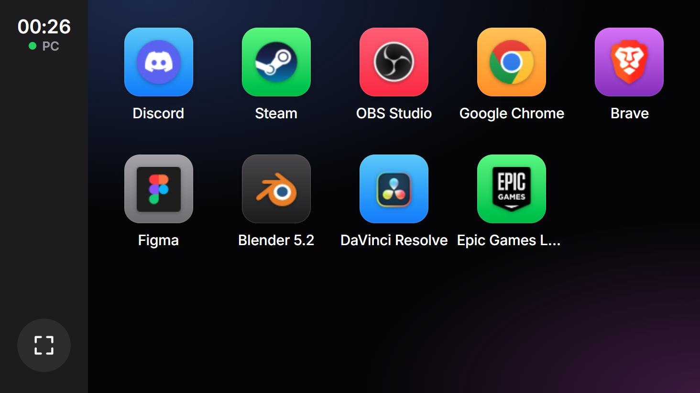
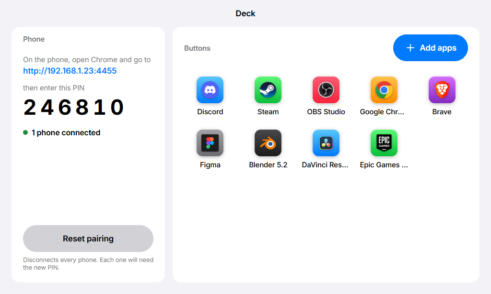
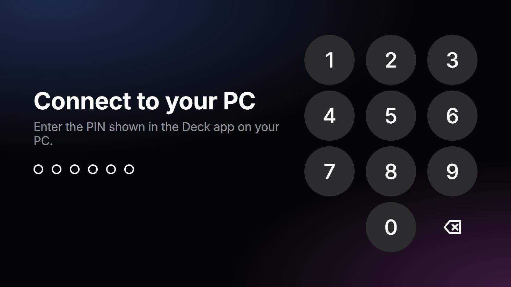

<div align="center">



# Glassdeck

### Your old phone, reborn as a touch deck for your PC 📱

Glassdeck turns a spare Android phone into a **CarPlay-style control surface** that sits
between your monitors. Tap an icon on the phone, and the app opens on your Windows PC —
no alt-tab, no leaving your game, no reaching for the mouse.

[](#-get-it)
[](#-get-it)
[](https://www.electronjs.org/)
[](https://react.dev/)
[](https://www.typescriptlang.org/)
[](LICENSE)

<br/>



</div>

> Every desk has an old phone in a drawer. Glassdeck gives it a job: a calm,
> glanceable deck of your favourite apps, styled like Apple CarPlay, always one tap away.
> No cloud, no accounts — everything stays on your home network.

---

## ✨ What it does

- 🚀 **Launches your apps** — tap a tile on the phone and the program opens on your PC. Programs, Start-menu shortcuts and Steam games all work.
- 🖼️ **Real app icons** — Glassdeck reads each app's own Windows icon and sets it in a CarPlay-style rounded tile.
- 🔁 **Recents in the sidebar** — the apps you tap most stay one touch away, just like CarPlay's dock.
- ⚡ **Live sync** — add, rename, recolour or reorder buttons on the PC and the phone updates instantly.
- ✅ **Clear feedback** — a tile pulses while launching, then shows a green check or a red badge.
- 🔌 **Reconnects by itself** — restart the PC app and the phone picks up where it left off, no re-pairing.
- 📱 **Built for landscape** — big touch targets, paged grid with swipe, one-tap full screen.
- 🔐 **Private by design** — the phone can only open what *you* added. No paths, no commands, nothing else.

---

## 👀 A closer look

<div align="center">



<br/><sub>The Glassdeck window on your PC: the phone address and PIN on the left, your buttons on the right.</sub>

<br/><br/>



<br/><sub>Pairing on the phone: a one-time PIN, entered on a passcode-style keypad.</sub>

</div>

---

## 📥 Get it

```bash
git clone https://github.com/VIK-DD/glassdeck.git
cd glassdeck
npm install
npm run desktop
```

Then, in three steps:

1. **Add apps** — in the Glassdeck window, click **Add apps** and pick programs (`.exe`),
   Start-menu shortcuts (`.lnk`) or Steam games (`.url`). The picker opens in your Start menu.
2. **Open it on the phone** — on the same Wi-Fi, open Chrome at the address shown in the window,
   e.g. `http://192.168.0.2:4455`.
3. **Pair** — enter the 6-digit PIN from the PC. The phone stays paired until you press **Reset pairing**.

> 💡 Tap the full-screen button in the phone's sidebar to hide Chrome's address bar.

<details>
<summary>First run & troubleshooting</summary>

- **Windows Firewall** asks for network access on first start — allow it on *private* networks.
- **Phone can't reach the PC?** Make sure it isn't on a *guest* Wi-Fi, and that the router's
  *AP isolation* is off. Both block devices from talking to each other.
- **Screen keeps turning off?** Android can't keep a web page awake over plain http. Set a long
  screen timeout, or turn on *Stay awake while charging* in Developer options.

</details>

<details>
<summary>Developing</summary>

```bash
npm run dev            # Vite dev server: phone page at http://<pc-ip>:5173/phone.html
npm run desktop:dev    # Electron on top of the dev server (run `npm run dev` first)
npm test               # Vitest: core model, LAN server security, storage, PIN guard
npm run typecheck
```

The architecture, data flow and security model are documented in
[`docs/ARCHITECTURE.md`](docs/ARCHITECTURE.md).

</details>

---

## 🧩 How it works

```
 Android phone (Chrome)                     Windows PC (Electron)
┌──────────────────────┐   tap → POST     ┌──────────────────────────────┐
│ CarPlay-style grid   │ ───────────────► │ LAN server :4455             │
│ PIN pairing          │                  │  └─ launches buttons by id   │
│ live button list     │ ◄─────────────── │ Glassdeck window (buttons,   │
└──────────────────────┘   SSE updates    │  PIN, connected phones)      │
                                          └──────────────────────────────┘
```

- **`electron/`** — the PC side: config storage, pairing PIN, the LAN server and app launching.
- **`src/phone/`** — the phone web app, served by the PC. Nothing to install on the phone.
- **`src/config/`** — the Glassdeck window where you manage buttons.
- **`src/core/`** — shared, platform-free logic (no React, DOM, Node or Electron — enforced by a test).
- **`src/ui/design-system/`** — the CarPlay-style components, built to map 1:1 to Figma.

---

## 🔐 Security

Glassdeck lets a phone open programs on your PC, so the server is strict about who can ask:

- **Launch by id only.** The phone never sends paths or commands — it can open only what you added.
- **One-time PIN pairing.** The PIN rotates after every use and after 5 wrong guesses. Pairing gives
  the phone a 256-bit token in an `HttpOnly`, `SameSite=Strict` cookie.
- **Cross-site requests blocked.** Every action needs a custom header and a matching origin.
- **Locked-down Electron.** Sandboxed window, context isolation, no Node in the page, validated IPC.

> ⚠️ Traffic on your local network is plain http. Use Glassdeck on a network you trust, like your home Wi-Fi.

---

## 🗺️ Roadmap

- [x] CarPlay-style launcher with real Windows app icons
- [x] PIN pairing, live sync and auto-reconnect
- [ ] **Liquid Glass** redesign, inspired by iOS 26
- [ ] **Now Playing** — control whatever is playing on the PC (Spotify, YouTube, …)
- [ ] **Mixer** — per-app volume, output switch, one-tap mic mute
- [ ] **Clip button** — save the last moments of your game via OBS replay buffer
- [ ] **System** — live GPU / CPU load, temperatures and FPS
- [ ] **Kiosk launcher** for Android — boots straight into Glassdeck, screen always on

---

<div align="center">

## 📜 License

[MIT](LICENSE) © 2026 VIK-DD — do whatever you like with it.

<br/>

Made to be calm, glanceable, and yours · Made in Moldova 🇲🇩

</div>
