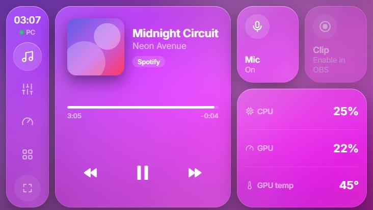
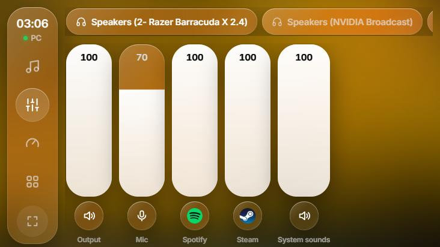
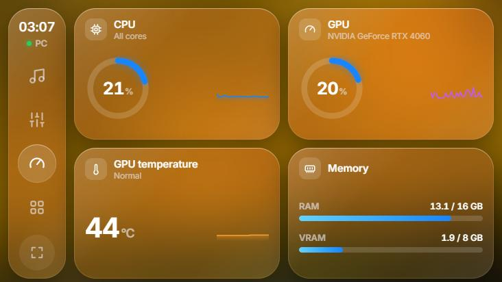

<div align="center">


# Glassdeck

### Your old phone, reborn as a Liquid Glass control center for your PC 📱

Glassdeck turns a spare Android phone into a **touch control center** that sits between your
monitors. See what's playing, mix every app's volume, mute your mic, clip your game and watch
your GPU — all without alt-tabbing, leaving your game or reaching for the mouse.

[](#-get-it)
[](#-get-it)
[](https://www.electronjs.org/)
[](https://react.dev/)
[](https://dotnet.microsoft.com/)
[](LICENSE)

<br/>



</div>

> Every desk has an old phone in a drawer. Glassdeck gives it a job: a calm, glanceable
> panel in iOS 26's Liquid Glass style, always one tap away. No cloud, no accounts —
> everything stays on your home network.

---

## ✨ What it does

- 🎵 **Now Playing** — whatever plays on your PC (Spotify, YouTube, anything), with cover, progress and big controls. The whole screen takes on the colours of the album art.
- 🎚️ **Mixer** — a Control Center–style slider for every app making sound, plus your output and mic. Tap an icon to mute it.
- 🎧 **Switch outputs** — jump between headset and speakers with one tap.
- 🎙️ **Mic mute** — one big button that turns red when you're muted. Works for every app at once.
- 🎬 **Clip button** — saves the last moments of your game through OBS's replay buffer (and arms it on first tap).
- 📊 **System** — live CPU and GPU load, GPU temperature and memory, with one-minute charts.
- 🚀 **Apps** — your favourite programs and games as tiles with their real icons; tap to launch on the PC.
- 🔐 **Private by design** — the phone can only do what's on screen. No paths, no commands, nothing else.

---

## 👀 A closer look

<div align="center">



<br/><sub>Mixer: pick the output on top, slide any app's volume, tap its icon to mute.</sub>

<br/><br/>



<br/><sub>System: load rings, a one-minute history and memory at a glance.</sub>

<br/><br/>


<br/><sub>The Glassdeck window on your PC: phone address and PIN, integration status and your app buttons.</sub>

</div>

---

## 📥 Get it

You need **Node.js 20+** and the **.NET 10 SDK** (for the small Windows helper that talks to the audio and media APIs).

```bash
git clone https://github.com/VIK-DD/glassdeck.git
cd glassdeck
npm install
npm run desktop
```

Then, in three steps:

1. **Open it on the phone** — on the same Wi-Fi, open Chrome at the address shown in the Glassdeck
   window, e.g. `http://192.168.0.2:4460`.
2. **Pair** — enter the 6-digit PIN from the PC. The phone stays paired until you press **Reset pairing**.
3. **Add apps** (optional) — click **Add apps** and pick programs (`.exe`), Start-menu shortcuts (`.lnk`)
   or Steam games (`.url`).

> 💡 Tap the full-screen button at the bottom of the phone's sidebar to hide Chrome's address bar.

<details>
<summary>Turning on the clip button (OBS)</summary>

In OBS, open **Tools → WebSocket Server Settings** and tick **Enable WebSocket server**. That's it —
Glassdeck reads the port and password from OBS's own settings, so there's nothing to copy.
For clips, set up the **Replay Buffer** under *Settings → Output*; the first tap on the phone arms it,
the next ones save clips.

</details>

<details>
<summary>First run & troubleshooting</summary>

- **Windows Firewall** asks for network access on first start — allow it on *private* networks.
- **Phone can't reach the PC?** Make sure it isn't on a *guest* Wi-Fi, and that the router's
  *AP isolation* is off. Both block devices from talking to each other.
- **Screen keeps turning off?** Android can't keep a web page awake over plain http. Set a long
  screen timeout, or turn on *Stay awake while charging* in Developer options.
- **GPU stats empty?** They come from `nvidia-smi`, so they need an NVIDIA card. CPU and memory
  work everywhere. CPU temperature isn't shown: Windows only exposes it to admin programs.

</details>

<details>
<summary>Developing</summary>

```bash
npm run dev            # Vite dev server: phone page at http://<pc-ip>:5173/phone.html
npm run desktop:dev    # Electron on top of the dev server (run `npm run dev` first)
npm run helper:build   # rebuild the Windows helper (C#) into dist-helper/
npm test               # Vitest: core model, server security, storage, OBS protocol, parsers
npm run typecheck
```

The architecture, data flow and security model are documented in
[`docs/ARCHITECTURE.md`](docs/ARCHITECTURE.md).

</details>

---

## 🧩 How it works

```
 Android phone (Chrome)              Windows PC
┌───────────────────────┐  commands ┌───────────────────────────────┐
│ Now · Mixer · System  │ ────────► │ Electron host  ── LAN :4460   │
│ · Apps (Liquid Glass) │           │  ├─ glassdeck-helper (C#)     │
│                       │ ◄──────── │  │   media · audio · outputs  │
└───────────────────────┘ live (SSE)│  ├─ nvidia-smi · CPU · memory │
                                    │  └─ OBS WebSocket             │
                                    └───────────────────────────────┘
```

- **`electron/`** — the PC side: LAN server, pairing PIN, config storage and the integrations.
- **`helper/`** — a tiny C# process for Windows' media session and Core Audio (per-app volume, mute, outputs).
- **`src/phone/`** — the phone web app, served by the PC. Nothing to install on the phone.
- **`src/config/`** — the Glassdeck window on the PC.
- **`src/core/`** — shared, platform-free logic (no React, DOM, Node or Electron — enforced by a test).
- **`src/ui/design-system/`** — the Liquid Glass components, built to map 1:1 to Figma.

---

## 🔐 Security

Glassdeck lets a phone control your PC, so the server is strict about who can ask and what:

- **A fixed set of actions.** The phone refers to apps, devices and buttons by id only — it can never
  send a path or a command. Every value (volume, target, device) is validated on the PC.
- **One-time PIN pairing.** The PIN rotates after every use and after 5 wrong guesses. Pairing gives
  the phone a 256-bit token in an `HttpOnly`, `SameSite=Strict` cookie.
- **Cross-site requests blocked.** Every action needs a custom header and a matching origin.
- **Locked-down Electron.** Sandboxed window, context isolation, no Node in the page, validated IPC.

> ⚠️ Traffic on your local network is plain http. Use Glassdeck on a network you trust, like your home Wi-Fi.

---

## 🗺️ Roadmap

- [x] CarPlay-style launcher with real Windows app icons
- [x] PIN pairing, live sync and auto-reconnect
- [x] **Liquid Glass** redesign, inspired by iOS 26
- [x] **Now Playing**, **Mixer**, **mic mute** and **output switching**
- [x] **Clip button** via OBS replay buffer
- [x] **System** — CPU / GPU load, GPU temperature, memory
- [ ] Seek by dragging the progress bar
- [ ] FPS counter in games
- [ ] **Kiosk launcher** for Android — boots straight into Glassdeck, screen always on

---

<div align="center">

## 📜 License

[MIT](LICENSE) © 2026 VIK-DD — do whatever you like with it.

<br/>

Made to be calm, glanceable, and yours · Made in Moldova 🇲🇩

</div>
